[English](README.md) · **Italiano**

<p align="center">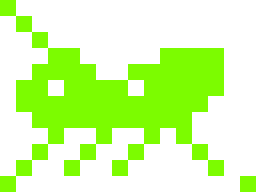</p>

# Grillo

Firmware modulare ad app per il LilyGO T-Dongle-S3 (variante con LCD 160x80, senza PSRAM).

Il nome viene dal grillo parlante: un piccolo aiutante da tenere in tasca. Il progetto nasce per l'installazione dei kiosk: si inserisce il dongle nel PC, si sceglie uno script e il dongle digita al posto di chi lo usa.

## Le app

| App | Cosa fa | Stato |
| --- | --- | --- |
| Injector | Esegue script Lua dalla microSD che digitano testo, premono combinazioni di tasti e muovono il mouse. Ogni script dichiara layout della tastiera e sistema operativo del PC di destinazione. | funzionante |
| Web Injector | Gli stessi script dell'Injector, scelti e seguiti da una pagina web protetta da PIN: elenco per cartelle, OS e tag, stato, dialoghi e abort dal telefono; cronologia della run anche dopo una riconnessione, esito che resta in pagina. | funzionante |
| Web Files | La microSD da una pagina web protetta da PIN: sfoglia, carica, scarica, rinomina, sposta, copia, cestino ed eliminazione definitiva; editor per script Lua (con controllo della sintassi sul dongle) e CSV a tabella. | funzionante |
| Web HID | Tastiera e touchpad comandati da una pagina web (PC o telefono), protetta da PIN. Layout e OS si scelgono dalla pagina. | funzionante |
| USB disk | Espone la microSD al PC come disco. | funzionante |
| Netscan | Scanner di rete: reti WiFi, controlli di connettività, host della LAN con produttore e nome, server DHCP (avviso se più di uno). Nessun port scan. Salva i risultati in CSV. | funzionante |

Il pulsante del dongle è l'unico ingresso: click, doppio click, pressione lunga; tenuto premuto 3 secondi esce da qualunque app. Ogni app ha un colore, usato dall'interfaccia e dal LED.

## Schermate

Catture dal display (160x80, ingrandite 4 volte) fatte con `tools/grillo.py shot`.

| | |
| --- | --- |
| 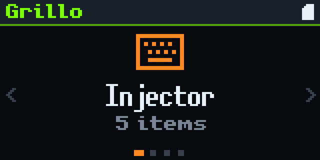 | 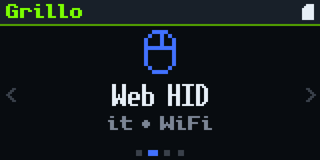 |
| 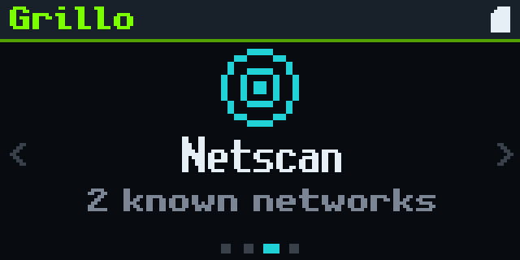 | 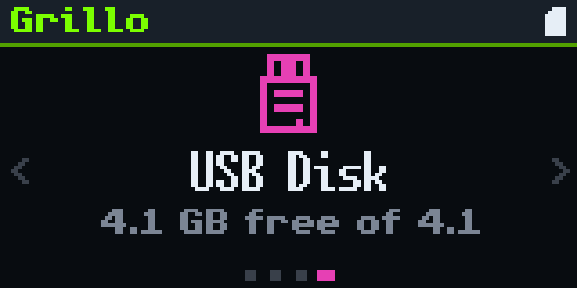 |
| 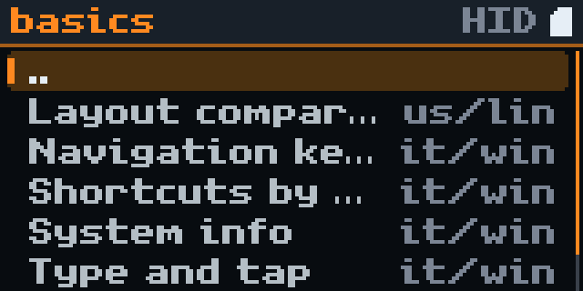 | 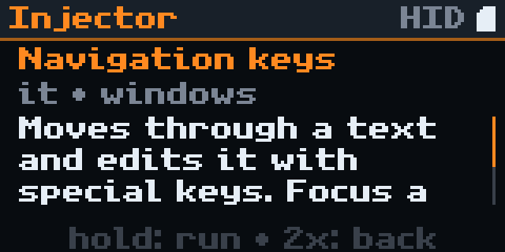 |
| 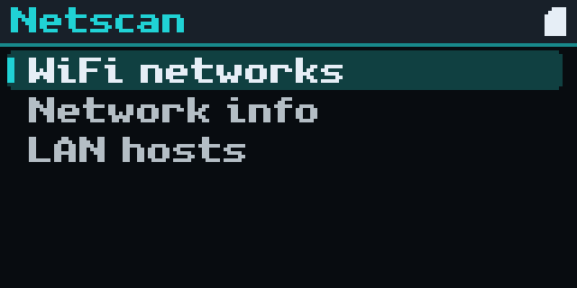 | 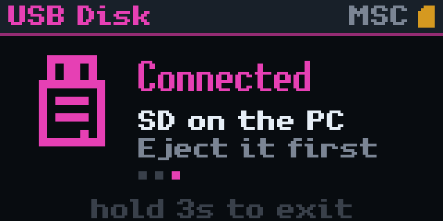 |
| 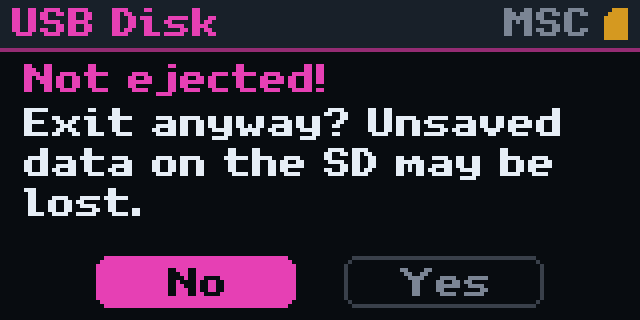 | |

Le pagine web (Web HID, Web Injector, Web Files) hanno un tema comune in tre modalità, scelte dal pulsante in alto a destra. Qui il Web Injector durante uno script, su un telefono (dati di esempio):

| Plain | Arcade | Retro |
| --- | --- | --- |
| 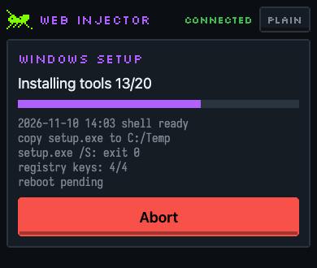 | 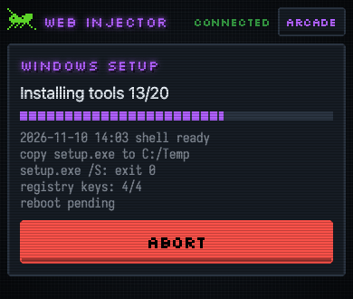 | 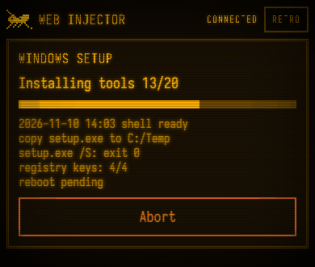 |

## Requisiti

- ESP-IDF v6.1, installato in `~/esp/esp-idf`
- microSD formattata FAT32 (exFAT non è supportato da ESP-IDF v6.1)
- Python 3 per gli strumenti in `tools/`

## Avvio rapido

```sh
. ~/esp/esp-idf/export.sh
idf.py build
idf.py -p /dev/cu.usbmodemXXXX flash
```

Poi copia il contenuto di `sd-template/` nella radice della microSD e inseriscila nel dongle. Il percorso completo, con il primo script, è in [Prima installazione](docs/it/tutorials/01-prima-installazione.md).

Per flashare senza compilare, usando l'immagine di una [release](https://github.com/Fede-26/grillo-dongle/releases) pubblicata, vedi [Flashare una release](docs/it/how-to/flash-una-release.md).

Per entrare in download mode, tieni premuto il pulsante mentre inserisci il dongle: quando il firmware usa la USB come tastiera o disco, la porta seriale di ESP-IDF non è disponibile.

## Documentazione

La documentazione in `docs/` segue il modello [Diátaxis](https://diataxis.fr/).

- **Tutorial**: [Prima installazione](docs/it/tutorials/01-prima-installazione.md), [Il tuo primo script](docs/it/tutorials/02-primo-script.md)
- **Guide pratiche**:
  - [Flashare una release](docs/it/how-to/flash-una-release.md)
  - [Collegare il dongle al WiFi](docs/it/how-to/wifi.md)
  - [Usare il Web HID](docs/it/how-to/web-hid.md)
  - [Usare il Web Injector](docs/it/how-to/web-injector.md)
  - [Usare Web Files](docs/it/how-to/web-files.md)
  - [Usare Netscan](docs/it/how-to/netscan.md)
  - [Scegliere layout e sistema operativo](docs/it/how-to/layout-e-os.md)
  - [Avviare uno script all'accensione](docs/it/how-to/autorun.md)
  - [Digitare una password senza scriverla negli script](docs/it/how-to/password.md)
  - [Copiare file sul PC con il disco USB](docs/it/how-to/copiare-file.md)
  - [Aggiungere un layout](docs/it/how-to/aggiungere-un-layout.md)
  - [Aggiungere un'app](docs/it/how-to/aggiungere-unapp.md)
- **Riferimento**: [API Lua](docs/it/reference/lua-api.md), [Intestazione degli script](docs/it/reference/intestazione-script.md), [config.lua](docs/it/reference/config-lua.md), [Protocollo WebSocket](docs/it/reference/protocollo-websocket.md), [Console di debug](docs/it/reference/console-debug.md), [API C delle app](docs/it/reference/api-app.md)
- **Spiegazioni**: [Architettura](docs/it/explanation/architettura.md), [Layout, sistema operativo e tasti morti](docs/it/explanation/layout-e-tasti-morti.md), [Sicurezza e rischi accettati](docs/it/explanation/sicurezza.md)

## Struttura del repository

```
apps/         le app (injector, webinjector, webhid, webfiles, netscan, usbdisk, launcher)
components/   i servizi condivisi (hid, usbdev, net, display, gfx, ui, storage, config, luart, ...)
main/         avvio, tabella delle app, console di debug
sd-template/  contenuto iniziale della microSD (config.lua, esempi, libreria)
tools/        generatori (layout, font), client della console di debug
test/host/    test della logica pura sul PC: make -C test/host
docs/         documentazione
```

## Strumenti

- `make -C test/host` esegue sul PC i test di layout, gesti del pulsante e logica pura di Netscan.
- `python3 tools/gen_layouts.py` rigenera `components/hid/layouts_data.c`.
- `python3 tools/make_oui.py oui.csv oui.bin` converte la lista OUI dell'IEEE per Netscan (vedi [Usare Netscan](docs/it/how-to/netscan.md)).
- `python3 tools/grillo.py cmd state` parla con la console di debug (vedi [riferimento](docs/it/reference/console-debug.md)).
- `python3 tools/serial_log.py /dev/cu.usbmodemXXXX 10` mostra il log per 10 secondi.

## VS Code

IntelliSense legge `build/compile_commands.json`. Esegui `idf.py build` (oppure `idf.py reconfigure`) almeno una volta: dopo, gli include si risolvono.

## Licenza

GPL-3.0-or-later, testo completo in [LICENSE](LICENSE). Fanno eccezione i componenti vendorizzati, ciascuno con la propria licenza originale: Lua ([MIT](components/lua/lua/lua.h)), i font Iosevka e Silkscreen (SIL OFL 1.1, testo in `components/webtheme/web/fonts/`) e il layout Colemak per Windows (pubblico dominio, vedi `tools/layouts/README.md`).

## Stato e limiti noti

- Non c'è un'app Impostazioni: le impostazioni si modificano a mano in `config.lua` sulla microSD.
- I ripieghi per i caratteri mancanti dal layout esistono solo per Windows (Alt + codice sul tastierino) e Linux (Ctrl+Shift+U); su macOS un carattere non digitabile con il layout è un errore.
- Le password in `config.lua` sono in chiaro sulla microSD, e il Web HID senza PIN lascia il controllo del PC a chiunque sia sulla stessa rete: vedi [Sicurezza](docs/it/explanation/sicurezza.md).
