**English** · [Italiano](README.it.md)

<p align="center"></p>

# Grillo

Modular, app-based firmware for the LilyGO T-Dongle-S3 (the variant with the 160x80 LCD, no PSRAM).

The name comes from the talking cricket (*grillo parlante*): a small helper to keep in your pocket. The project was born for kiosk installation: you plug the dongle into the PC, pick a script, and the dongle types in place of the user.

## The apps

| App | What it does | Status |
| --- | --- | --- |
| Injector | Runs Lua scripts from the microSD that type text, press key combinations and move the mouse. Each script declares the keyboard layout and operating system of the target PC. | working |
| Web Injector | The same scripts as the Injector, chosen and followed from a PIN-protected web page: list by folder, OS and tag, status, dialogs and abort from the phone; run history even after a reconnection, outcome that stays on the page. | working |
| Web Files | The microSD from a PIN-protected web page: browse, upload, download, rename, move, copy, trash and permanent deletion; editor for Lua scripts (with syntax check on the dongle) and CSV as a table. | working |
| Web HID | Keyboard and touchpad driven from a web page (PC or phone), PIN-protected. Layout and OS are chosen from the page. | working |
| USB disk | Exposes the microSD to the PC as a disk. | working |
| Netscan | Network scanner: WiFi networks, connectivity checks, LAN hosts with vendor and name, DHCP servers (warning if more than one). No port scan. Saves results to CSV. | working |

The dongle's button is the only input: click, double click, long press; held for 3 seconds it exits any app. Each app has a color, used by the interface and by the LED.

## Screenshots

Captures from the display (160x80, scaled 4x) taken with `tools/grillo.py shot`.

| | |
| --- | --- |
| 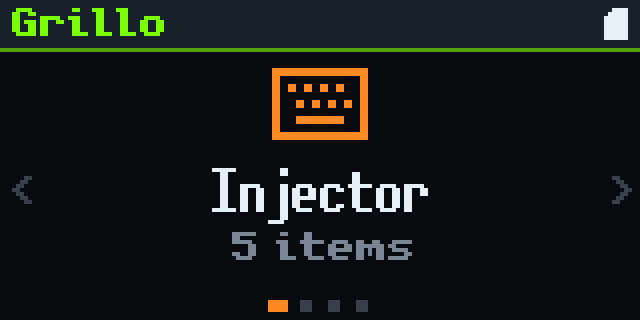 | 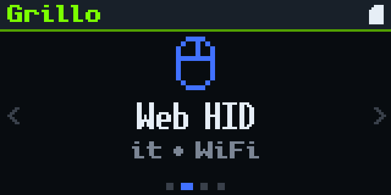 |
| 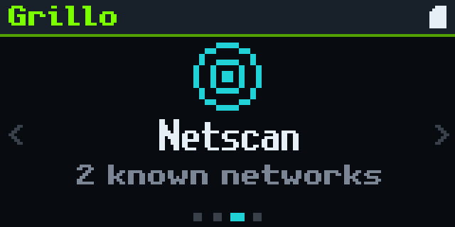 | 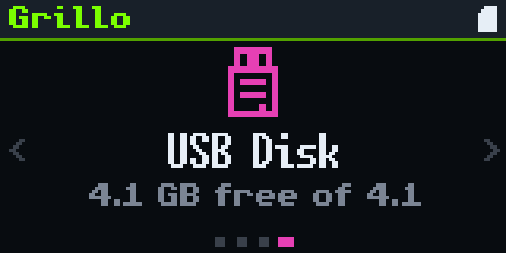 |
| 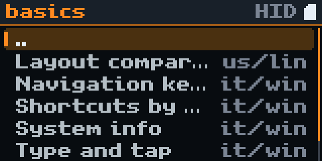 | 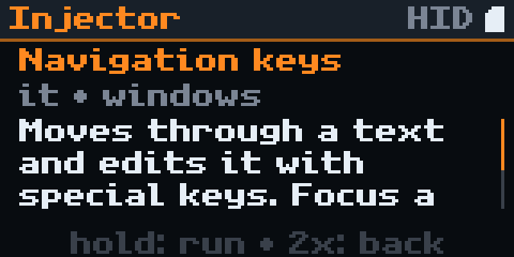 |
| 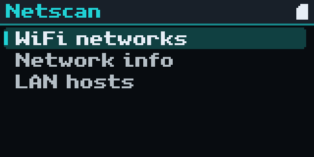 | 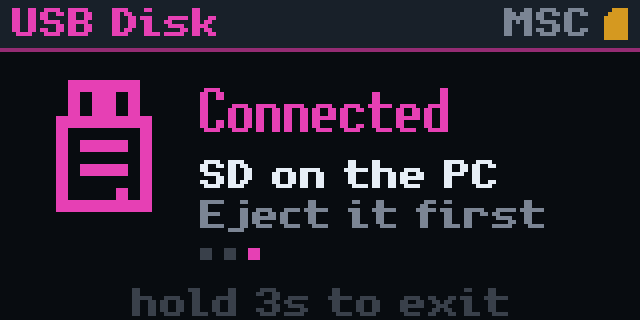 |
| 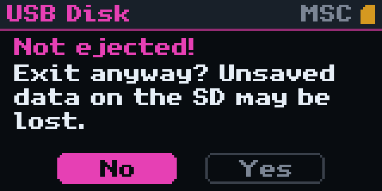 | |

The web pages (Web HID, Web Injector, Web Files) share a common theme in three modes, chosen with the button at the top right. Here the Web Injector during a script, on a phone (sample data):

| Plain | Arcade | Retro |
| --- | --- | --- |
| 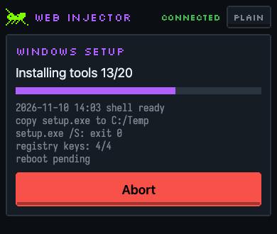 | 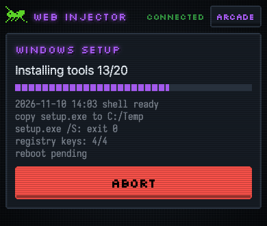 | 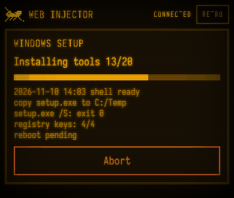 |

## Requirements

- ESP-IDF v6.1, installed in `~/esp/esp-idf`
- microSD formatted FAT32 (exFAT is not supported by ESP-IDF v6.1)
- Python 3 for the tools in `tools/`

## Quick start

```sh
. ~/esp/esp-idf/export.sh
idf.py build
idf.py -p /dev/cu.usbmodemXXXX flash
```

Then copy the contents of `sd-template/` to the root of the microSD and insert it into the dongle. The full walkthrough, with the first script, is in [First install](docs/tutorials/01-first-install.md).

To flash without building, using the image of a published [release](https://github.com/Fede-26/grillo-dongle/releases), see [Flash a release](docs/how-to/flash-a-release.md).

To enter download mode, hold the button while plugging in the dongle: when the firmware uses USB as a keyboard or disk, the ESP-IDF serial port is not available.

## Documentation

The documentation in `docs/` follows the [Diátaxis](https://diataxis.fr/) model.

- **Tutorials**: [First install](docs/tutorials/01-first-install.md), [Your first script](docs/tutorials/02-first-script.md)
- **How-to guides**:
  - [Flash a release](docs/how-to/flash-a-release.md)
  - [Connect the dongle to WiFi](docs/how-to/wifi.md)
  - [Use Web HID](docs/how-to/web-hid.md)
  - [Use the Web Injector](docs/how-to/web-injector.md)
  - [Use Web Files](docs/how-to/web-files.md)
  - [Use Netscan](docs/how-to/netscan.md)
  - [Choose layout and operating system](docs/how-to/layout-and-os.md)
  - [Run a script at power-on](docs/how-to/autorun.md)
  - [Type a password without writing it in scripts](docs/how-to/passwords.md)
  - [Copy files to the PC with the USB disk](docs/how-to/copy-files.md)
  - [Add a layout](docs/how-to/add-a-layout.md)
  - [Add an app](docs/how-to/add-an-app.md)
- **Reference**: [Lua API](docs/reference/lua-api.md), [Script header](docs/reference/script-header.md), [config.lua](docs/reference/config-lua.md), [WebSocket protocol](docs/reference/websocket-protocol.md), [Debug console](docs/reference/debug-console.md), [App C API](docs/reference/app-api.md)
- **Explanation**: [Architecture](docs/explanation/architecture.md), [Layouts, operating systems and dead keys](docs/explanation/layouts-and-dead-keys.md), [Security and accepted risks](docs/explanation/security.md)

## Repository layout

```
apps/         the apps (injector, webinjector, webhid, webfiles, netscan, usbdisk, launcher)
components/   shared services (hid, usbdev, net, display, gfx, ui, storage, config, luart, ...)
main/         startup, app table, debug console
sd-template/  initial microSD contents (config.lua, examples, library)
tools/        generators (layouts, fonts), debug console client
test/host/    pure-logic tests on the PC: make -C test/host
docs/         documentation
```

## Tools

- `make -C test/host` runs on the PC the tests for layouts, button gestures and Netscan pure logic.
- `python3 tools/gen_layouts.py` regenerates `components/hid/layouts_data.c`.
- `python3 tools/make_oui.py oui.csv oui.bin` converts the IEEE OUI list for Netscan (see [Use Netscan](docs/how-to/netscan.md)).
- `python3 tools/grillo.py cmd state` talks to the debug console (see [reference](docs/reference/debug-console.md)).
- `python3 tools/serial_log.py /dev/cu.usbmodemXXXX 10` shows the log for 10 seconds.

## VS Code

IntelliSense reads `build/compile_commands.json`. Run `idf.py build` (or `idf.py reconfigure`) at least once: after that, includes resolve.

## License

GPL-3.0-or-later, full text in [LICENSE](LICENSE). The exceptions are the vendored components, each under its own original license: Lua ([MIT](components/lua/lua/lua.h)), the Iosevka and Silkscreen fonts (SIL OFL 1.1, text in `components/webtheme/web/fonts/`) and the Colemak layout for Windows (public domain, see `tools/layouts/README.md`).

## Status and known limitations

- There is no Settings app: settings are edited by hand in `config.lua` on the microSD.
- Fallbacks for characters missing from the layout exist only for Windows (Alt + code on the numeric keypad) and Linux (Ctrl+Shift+U); on macOS a character that cannot be typed with the layout is an error.
- Passwords in `config.lua` are in plain text on the microSD, and Web HID without a PIN hands control of the PC to anyone on the same network: see [Security](docs/explanation/security.md).
